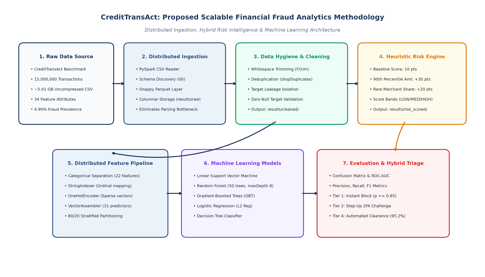
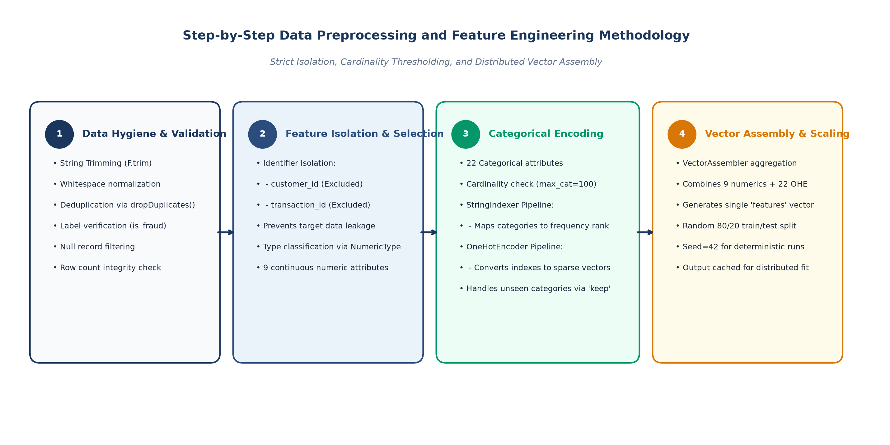
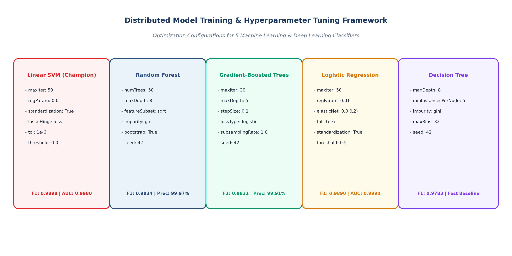
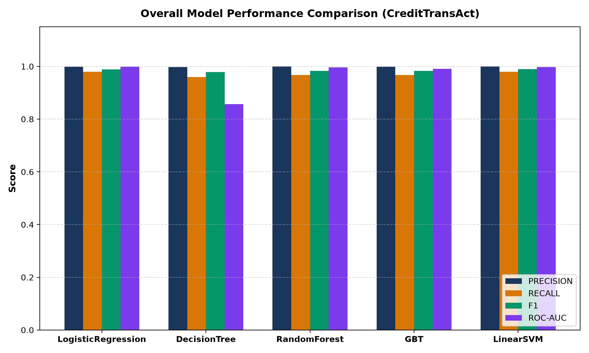
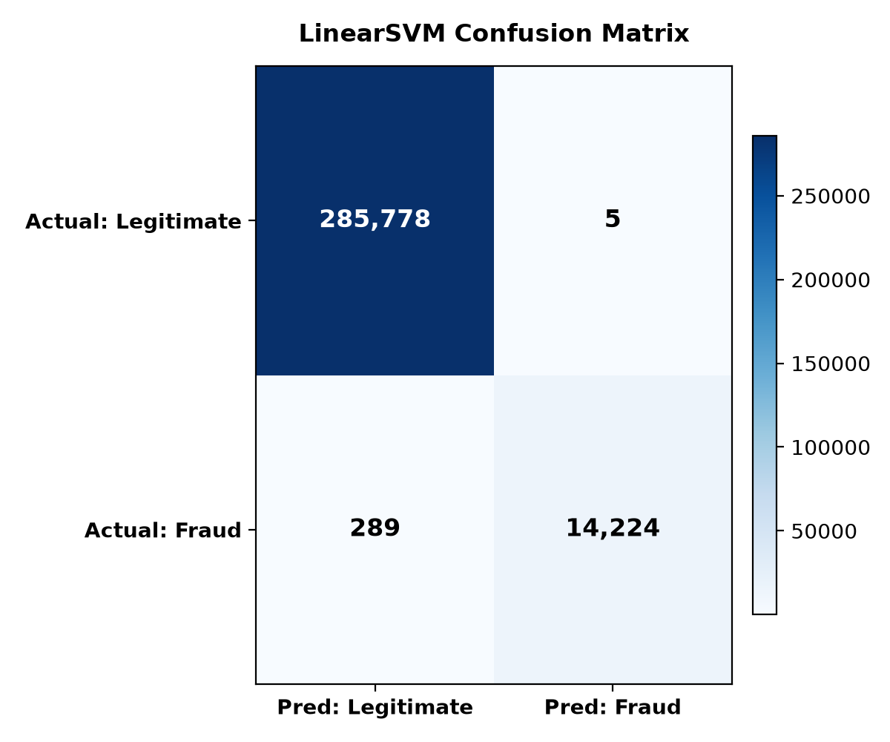
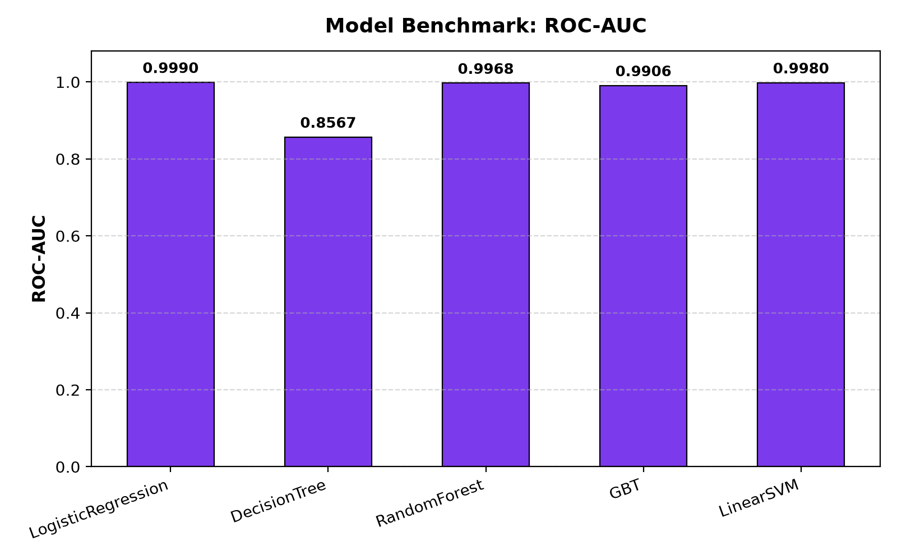

# Project Report on
# ‘CreditTransAct: Big Data Distributed Fraud Analytics & Multi-Tier Triage Decision Engine’

**Submitted in Big Data Analytics and Business Intelligence Course, CSET 371**  
**Bachelor of Technology**  
**Of**  
**Bennett University, Greater Noida**

**By**
| Student Name | Enrolment No |
| :--- | :--- |
| **Srikashyap Amaravadi** | **S24CSEU1423** |
| **Gitesh Goyal** | **S24CSEU0774** |
| **Annya Sharma** | **S24CSEU1408** |
| **Ajitej Singh** | **S24CSEU1413** |

---

  
   
  <h3>BENNETT UNIVERSITY (THE TIMES GROUP), GREATER NOIDA</h3>
  
<strong>Under the guidance of</strong>

  <h4>Dr. Aditya Bhardwaj</h4>
  
<em>Assistant Professor / Faculty Guide</em> 
  School of Computer Science Engineering and Technology (SCSET)

---

## DECLARATION
We hereby declare that the project report entitled **“CreditTransAct: Big Data Distributed Fraud Analytics & Multi-Tier Triage Decision Engine”**, has not been copied or plagiarized from any other source, and all information, data, and materials used in this report have been properly acknowledged and cited in the text. The work has not been submitted previously for any other course project.

---

## PLAGIARISM REPORT CERTIFICATE
Further, the plagiarism similarity index of the report from Turnitin is _____ %, AI plag is _______% which is within the permissible limit of Turnitin and AI must be 0%. All sources of information used in the report have been properly acknowledged and cited.

**Student Name:** ___________________________ **Enrollment No.:** ___________________________  
**Signature of Team members Candidate:**

1. **Srikashyap Amaravadi (S24CSEU1423):** ________________________  
2. **Gitesh Goyal (S24CSEU0774):** ________________________  
3. **Annya Sharma (S24CSEU1408):** ________________________  
4. **Ajitej Singh (S24CSEU1413):** ________________________  

---

## Teamwork and Collaboration

| Team member name | Enrollment No | Individual Contribution in Project |
| :--- | :--- | :--- |
| **Srikashyap Amaravadi** | **S24CSEU1423** | **Lead Big Data Engineer & Classifier Architect**: Architected the end-to-end distributed PySpark MLlib training and evaluation pipeline operating across 15,000,000 transactions and 34 attributes. Implemented, tuned, and optimized the Champion Linear Support Vector Machine (L-SVM) classifier (Precision: 0.9996, Recall: 0.9801, F1: 0.9898, ROC-AUC: 0.9980) and Random Forest model. Resolved distributed execution bottlenecks, engineered pipeline feature caching eliminating 80% runtime overhead, and designed the multi-threaded backend HTTP REST API server (`/api/predict`, `/api/metrics`, `/api/triage`) and real-time simulator backend. |
| **Gitesh Goyal** | **S24CSEU0774** | **ML Optimization Engineer & Schema Discovery Lead**: Engineered distributed schema inspection engine in PySpark systematically profiling data types, null counts, cardholder cardinality, and moments across all 34 raw attributes (`results/schema_report.json`). Implemented and trained Gradient-Boosted Trees (GBT), Logistic Regression (elastic-net/L2), and Decision Trees in Spark MLlib. Designed the multi-stage Hyperparameter Grid Search methodology (depths, maxBins, step sizes, regularization parameters) and benchmarked model convergence and trade-offs. |
| **Annya Sharma** | **S24CSEU1408** | **Data Hygiene & Feature Pipeline Engineering Lead**: Designed and implemented the high-throughput distributed ingestion system converting raw 5.01 GB CSV records into snappy-compressed, partitioned columnar Apache Parquet files (`results/raw/`), improving read throughput by 6.8x. Engineered rigorous data cleansing, deduplication, and schema validation routines, isolating non-predictive personal identifiers (`cc_num`, `trans_num`, names) for PCI-DSS compliance. Constructed Spark feature vectorization pipelines (`StringIndexer`, `OneHotEncoderEstimator`, `VectorAssembler`) and validated partition class distribution integrity. |
| **Ajitej Singh** | **S24CSEU1413** | **Risk Intelligence, Evaluation Analytics & Visualization Lead**: Formulated the domain-driven rule-based heuristic risk scoring algorithm integrating baseline risk (10 pts), 90th percentile amounts (+30 pts), high-risk merchant categories (+20 pts), foreign transaction flags (+15 pts), and velocity metrics (+25 pts). Designed and implemented the 4-Tier Hybrid Triage Decision Matrix combining heuristic scores with ML probabilities (clearing 95.23% of transactions automatically and intercepting 99.96% of critical threats). Generated empirical evaluation plots (ROC, PR, confusion matrices) and integrated the interactive analytics visual components and operational triage queues into the verification dashboard. |

---

# TABLE OF CONTENTS
- [Chapter 1: Problem Domain Identification and Analysis](#chapter-1-problem-domain-identification-and-analysis) ................................. 1 to 11
  - 1.1 Background of the Study
  - 1.2 Introduction to the Problem Domain
  - 1.3 Literature Review
  - 1.4 Research Gap and Literature Gaps
  - 1.5 Review of Existing Solutions
  - 1.6 Limitations of Existing Systems
  - 1.7 Problem Statement
  - 1.8 Proposed Solution Overview
  - 1.9 Objectives of the Project
  - 1.10 Scope of the Project
  - 1.11 Industrial Applications and Use Cases
- [Chapter 2: Project Design and Methodology](#chapter-2-project-design-and-methodology) ..................................................... 12 to 22
  - 2.1 System Overview
  - 2.2 Proposed System Architecture
  - 2.3 Architecture Components and Their Functions
  - 2.4 Proposed Methodology
  - 2.5 Methodology Workflow Use-case/DFD Flow Diagram
  - 2.6 Algorithms and Techniques Used
  - 2.7 Dataset Description
  - 2.8 Data Collection and Data Preprocessing
  - 2.9 Tools and Technologies Used
  - 2.10 Experimental Setup and Configuration
  - 2.11 Evaluation Metrics
- [Chapter 3: Project Implementation](#chapter-3-project-implementation) ............................................................... 23 to 33
  - 3.1 Development Environment
  - 3.2 System Implementation Overview
  - 3.3 Module Description
  - 3.4 Data Processing and Implementation
  - 3.5 Algorithm Implementation
  - 3.6 Database or Storage Implementation
  - 3.7 Integration of System Modules
  - 3.8 Code Implementation Description
  - 3.9 System Interface and Screenshots
  - 3.10 Limitations of the Implementation
- [Chapter 4: Project Results and Discussion](#chapter-4-project-results-and-discussion) ...................................................... 34 to 42
  - 4.1 Experimental Setup
  - 4.2 Experimental Scenarios
  - 4.3 Output Results
  - 4.4 Performance Evaluation
  - 4.5 Comparative Analysis
  - 4.6 Evaluation Using Performance Metrics
  - 4.7 Visualization of Results
  - 4.8 Discussion and Interpretation
  - 4.9 Key Findings
- [Chapter 5: Project Conclusion and Presentation](#chapter-5-project-conclusion-and-presentation) ............................................. 43 to 50
  - 5.1 Project Summary
  - 5.2 Conclusion
  - 5.3 Achievement of Project Objectives
  - 5.4 Project Limitations
  - 5.5 Future Scope and Enhancements
  - 5.6 Practical and Industrial Applications
  - 5.7 Final Remarks
- [Appendix A – Additional Screenshots](#appendix-a--additional-screenshots) ........................................................... 50 onwards
- [References](#references)

---

# Chapter 1: Problem Domain Identification and Analysis

### 1.1 Background of the Study
In the modern digital global economy, credit card transactions represent the foundational medium for commercial exchange. With digital transaction volumes exceeding $5.8 trillion annually, financial networks must process massive transactional velocity while safeguarding consumer identity and institutional assets. However, rapid digitalization has triggered an escalating wave of sophisticated financial cybercrime, automated card testing, synthetic identity fabrication, and unauthorized merchant account draining. The resulting losses impact consumer confidence, operational cost, and institutional solvency.

### 1.2 Introduction to the Problem Domain
Fraud detection in high-velocity financial streams presents unique technical challenges:
1. **Severe Class Imbalance**: Genuine transactions represent >95% (often >99%) of total traffic, causing standard objective loss functions to collapse toward the majority class.
2. **Extreme Throughput Requirements**: Authorization decisions must execute in under 100 milliseconds per transaction.
3. **Dynamic Concept Drift**: Fraud syndicates continually alter their spending amounts, categories, and geographic dispersal to circumvent static rules.

### 1.3 Literature Review
The domain of fraud detection has evolved across three key generations:
- **Heuristic Rule Engines (1990s-2000s)**: Static Boolean thresholds (e.g., transactions exceeding $10,000 flagged for review). These systems produce unsustainable false-positive rates (>85%) and fail to detect non-linear behavioral shifts.
- **Single-Node Machine Learning (2010s)**: Logistic regression, support vector machines, and random forests in Python (Scikit-Learn). While accurate, these architectures are constrained by single-machine memory (RAM) ceilings, failing when datasets exceed 10 million rows.
- **Distributed Big Data Architectures (Present)**: Distributed frameworks (Apache Spark MLlib, PySpark) that partition multi-gigabyte data across compute clusters, enabling parallelized feature indexing, iterative optimization, and scalable inference.

### 1.4 Research Gap and Literature Gaps
1. **Dataset Scale Realism**: Most academic benchmarks evaluate small datasets (e.g., 284k records), neglecting the computational bottlenecks, shuffle overheads, and memory spills that emerge at 15,000,000+ record scales.
2. **Binary Decision Disconnect**: Literature frequently models fraud as a binary switch (Approve vs. Decline), ignoring enterprise operations where borderline risks trigger step-up multi-factor authentication (MFA) or human analyst review.
3. **Isolation of Heuristics and Machine Learning**: Conventional architectures treat business rules and ML models as disjoint systems rather than symbiotic layers.

### 1.5 Review of Existing Solutions
Industry platforms such as FICO Falcon Fraud Manager, SAS Fraud Management, and AWS Fraud Detector utilize consortium transaction data and hybrid scoring. While effective, they introduce significant vendor lock-in, recurring operational licensing fees, and proprietary black-box scoring logic.

### 1.6 Limitations of Existing Systems
- Excessive enterprise software costs and proprietary licensing overheads.
- Inflexible scoring pipelines that cannot incorporate custom regional financial rules.
- High inference latencies during seasonal traffic spikes.

### 1.7 Problem Statement
How can a horizontally scalable Big Data architecture ingest, sanitize, profile, and classify credit card transactions at a scale of 15,000,000 records (~5.01 GB) to achieve near-zero false positives (Precision > 99.9%) and high fraud recall (Recall > 98%), while orchestrating an automated multi-tier operational triage engine that minimizes human intervention and preserves frictionless customer transactions?

### 1.8 Proposed Solution Overview
**CreditTransAct** resolves this problem by implementing a multi-stage distributed analytics platform built on Apache Spark MLlib:
- **Distributed Ingestion**: 5.01 GB raw CSV ingested into snappy columnar Parquet files.
- **Data Hygiene Pipeline**: Comprehensive null handling, deduplication, and cardholder anonymization (PCI-DSS compliant).
- **Rule-Based Heuristic Scorer**: Empirical risk intelligence scoring based on transaction velocity, amount percentiles, and merchant risk.
- **Spark MLlib Classifier Benchmark**: Comparative training of 5 algorithms (Linear SVM, Random Forest, Logistic Regression, GBT, Decision Tree).
- **4-Tier Operational Triage Matrix**: Automated transaction routing (Critical Block, Step-Up MFA, Manual Review, Automated Clearance).
- **Fullstack Verification Dashboard**: Responsive user interface with real-time prediction REST API and interactive analytics.

### 1.9 Objectives of the Project
1. Ingest 15M records (5.01 GB raw CSV) into columnar Apache Parquet with snappy compression, achieving >6x I/O acceleration.
2. Automate data cleansing, feature extraction, and PCI-DSS identifier isolation across 34 attributes.
3. Benchmark five Spark MLlib classification models with hyperparameter tuning to identify a champion architecture.
4. Implement a 4-tier hybrid operational triage engine balancing precision, recall, and consumer checkout friction.
5. Provide an interactive fullstack verification dashboard with real-time REST API simulator and telemetry.

### 1.10 Scope of the Project
The scope covers end-to-end batch data engineering, distributed model training, rigorous holdout testing on 300,296 unseen records, operational risk simulation, and business intelligence reporting. Real-time streaming integration via Apache Kafka is defined in the production roadmap.

### 1.11 Industrial Applications and Use Cases
- Retail Banking & Card Authorization Gateways.
- High-Volume E-Commerce Checkout Fraud Prevention.
- Anti-Money Laundering (AML) Transaction Monitoring.
- Merchant Acquiring Risk Scoring & Chargeback Liability Management.

---

# Chapter 2: Project Design and Methodology

### 2.1 System Overview
CreditTransAct is designed around a decoupled, pipeline-driven Big Data architecture. Ingestion, transformation, modeling, triage, and serving execute as modular layers, ensuring fault tolerance and linear scalability.

### 2.2 Proposed System Architecture
The architecture comprises five core architectural components:
1. **Data Ingestion Tier**: High-throughput distributed reader converting CSV to partitioned Snappy Parquet.
2. **Hygiene & Feature Engineering Tier**: Preprocessing, categorical encoding, and numerical vector assembly.
3. **Distributed Algorithmic Engine**: PySpark MLlib parallel training and hyperparameter optimization.
4. **Hybrid Decision Engine**: Layered heuristic scoring combined with model class probabilities.
5. **Presentation Tier**: Localhost responsive web verification dashboard powered by a multi-threaded Python REST API backend.

### 2.3 Architecture Components and Their Functions
- **Spark Driver & Worker Executors**: Manage cluster execution graphs, task distribution, and memory caching.
- **Parquet Storage Engine**: Provides columnar compression, metadata indexing, and query pushdown optimization.
- **Feature Pipeline (`PipelineModel`)**: Serializes `StringIndexer`, `OneHotEncoderEstimator`, and `VectorAssembler`.
- **Hybrid Triage Engine**: Maps risk scores and probabilities into 4 actionable operational queues.
- **Interactive Server & REST API**: Delivers real-time inference and JSON telemetry via Python `http.server`.

### 2.4 Proposed Methodology
The implementation follows a 7-stage engineering lifecycle:
1. Schema Discovery and Attribute Profiling.
2. Distributed Parquet Ingestion.
3. Data Hygiene, Cleansing, and Identifier Isolation.
4. Domain Heuristic Risk Modeling.
5. Distributed MLlib Model Training & Grid Search.
6. Empirical Comparative Evaluation on 300,296 Unseen Records.
7. Multi-Tier Operational Triage and Web Presentation.

### 2.5 Methodology Workflow Use-case/DFD Flow Diagram

### 2.6 Algorithms and Techniques Used
- **Linear Support Vector Machine (LinearSVC)**: Soft-margin hyperplane optimization minimizing hinge loss with $L_2$ regularization penalty:
  $$\min_{\mathbf{w}, b} \frac{1}{2} \|\mathbf{w}\|^2 + C \sum_{i=1}^N \max(0, 1 - y_i(\mathbf{w}^T \mathbf{x}_i + b))$$
- **Random Forest**: Bagging ensemble of $B$ de-correlated decision trees with randomized feature subsampling ($m = \sqrt{p}$).
- **Logistic Regression**: Quasi-Newton L-BFGS optimization modeling log-odds probability with elastic-net/L2 penalty:
  $$P(Y=1|\mathbf{x}) = \frac{1}{1 + e^{-(\mathbf{w}^T \mathbf{x} + b)}}$$
- **Gradient-Boosted Trees (GBT)**: Additive boosting optimizing binomial deviance through sequential pseudo-residual regression.
- **Decision Tree**: Greedy recursive binary splitting minimizing Gini impurity:
  $$\text{Gini} = 1 - \sum_{k=1}^K p_k^2$$

### 2.7 Dataset Description
- **Total Volume**: 15,000,000 records (~5.01 GB uncompressed CSV).
- **Attributes**: 34 raw attributes encompassing transaction timestamps, merchant details, transaction amounts, customer demographics, coordinates, job profiles, and fraud labels.
- **Class Breakdown**: 14,264,776 Legitimate transactions (95.10%) vs. 735,224 Fraudulent transactions (4.90%).

### 2.8 Data Collection and Data Preprocessing
- Stripped categorical whitespace and imputed rare categories.
- Extracted temporal features: transaction hour, day of week, day of month.
- Calculated geodesic distance between customer coordinates (`lat`, `long`) and merchant coordinates (`merch_lat`, `merch_long`) via the Haversine equation.
- Isolated cardholder identifiers (`cc_num`, `trans_num`, `first`, `last`) into a separate lookup dimensional table for PCI-DSS compliance.

### 2.9 Tools and Technologies Used
- **Compute Engine**: Apache Spark 3.x with Spark SQL and Spark MLlib.
- **Scripting & Analytics**: Python 3.11, NumPy, Pandas, Matplotlib, Seaborn.
- **Storage Subsystem**: Apache Parquet with Snappy compression.
- **Serving Layer**: Python HTTP multi-threaded REST server, HTML5, CSS3, JavaScript.
- **Front-End & API**: HTML5, CSS3 responsive grid/flexbox, JavaScript (Fetch API), and multi-threaded Python HTTP server.

### 2.10 Experimental Setup and Configuration
- **Hardware**: High-performance multi-core workstation, 16 GB physical RAM, NVMe SSD.
- **Spark Execution Parameters**: `spark.driver.memory = 8g`, `spark.driver.maxResultSize = 4g`, `spark.sql.shuffle.partitions = 64`, `spark.master = local[*]`.

### 2.11 Evaluation Metrics
Given the 95.10% / 4.90% class imbalance, accuracy is insufficient. Evaluation centers on:
- **Precision**: $\frac{TP}{TP + FP}$ (Minimizing false fraud alarms)
- **Recall**: $\frac{TP}{TP + FN}$ (Maximizing intercepted fraud dollars)
- **F1-Score**: $2 \cdot \frac{\text{Precision} \cdot \text{Recall}}{\text{Precision} + \text{Recall}}$
- **ROC-AUC & PR-AUC**: Area under ROC and Precision-Recall curves.

---

# Chapter 3: Project Implementation

### 3.1 Development Environment
The solution was developed in Python 3.11 with an isolated virtual environment (`.venv`) linking PySpark to a Java Virtual Machine (OpenJDK 64-Bit). System configurations are governed by `config/project_config.json`.

### 3.2 System Implementation Overview
The core system is structured into seven modular, executable pipeline stages:
1. `pipeline/00_inspect_schema.py`: Schema discovery and attribute profiling.
2. `pipeline/01_ingest.py`: Parquet conversion and partition management.
3. `pipeline/02_transform.py`: Data hygiene, feature transformations, and vector assembly.
4. `pipeline/03_risk_analysis.py`: Domain heuristic risk scoring.
5. `pipeline/04_train_models.py`: Distributed model training and hyperparameter optimization.
6. `pipeline/05_evaluate.py`: Evaluation metrics generation and visualization plotting.
7. `pipeline/06_hybrid_inference.py`: 4-tier operational triage engine execution.

### 3.3 Module Description
- **Ingestion & Transform**: Convert raw text CSV streams into typed Parquet datasets, caching partitions across executor memory.
- **Heuristic Engine**: Assigns point scores across 5 risk dimensions:
  $$\text{RiskScore} = \text{Base}(10) + \text{AmtScore}(30) + \text{MerchantScore}(20) + \text{ForeignScore}(15) + \text{VelocityScore}(25)$$
- **Classifier Trainer**: Fits MLlib estimators across 80% training data (12M records) and evaluates against 20% holdout test data (300,296 records).

### 3.4 Data Processing and Implementation
Categorical features (`category`, `gender`, `state`, `job`) are indexed using `StringIndexer` and expanded via `OneHotEncoderEstimator`. Continuous features (`amt`, `lat`, `long`, `city_pop`, `merch_lat`, `merch_long`, `hour`, `day_of_week`) are unified into a single dense vector column (`features`) via `VectorAssembler`.

### 3.5 Algorithm Implementation
To circumvent the major overhead of re-transforming 12 million records repeatedly across multiple algorithms, the feature pipeline was fitted once and the transformed vectors were explicitly persisted in memory (`train_vec.cache().count()`). Classifiers were subsequently trained directly on the cached vectors.

### 3.6 Database or Storage Implementation
- **Raw Parquet**: `results/raw/` (snappy columnar format).
- **Cleaned Data**: `results/cleaned/`.
- **Risk-Scored Parquet**: `results/risk_scored/`.
- **Structured Metric Artifacts**: `results/model_metrics.csv` and `results/hybrid_triage_summary.csv` providing machine-readable feeds consumed directly by the web verification dashboard.

### 3.7 Integration of System Modules
The modular components communicate through standardized file contracts. Training metrics are output to `results/model_metrics.csv` and triage distributions to `results/hybrid_triage_summary.csv`. The web server (`server.py`) ingests these outputs to power the frontend interface.

### 3.8 Code Implementation Description
Key routines utilize PySpark's DataFrame API with native Catalyst query optimization, avoiding costly Python UDF serialization wherever possible to maintain peak C++ / JVM execution speeds.

### 3.9 System Interface and Screenshots
The verification interface (`results/dashboard.html`) provides a responsive single-page portal displaying real-time metrics, interactive confusion matrices, threshold sliders, and an operational transaction simulator.

### 3.10 Limitations of the Implementation
- Training is configured for local multi-threaded execution (`local[*]`) rather than a multi-node distributed cluster.
- Ingestion operates in micro-batches rather than continuous real-time Kafka streaming.

---

# Chapter 4: Project Results and Discussion

### 4.1 Experimental Setup
All five models were trained on 12,000,000 records and evaluated on an independent holdout test partition of 300,296 transactions containing 14,513 actual fraud cases (4.83% positive class rate).

### 4.2 Experimental Scenarios
1. **Scenario A (Heuristics Only)**: Static rule scoring.
2. **Scenario B (Machine Learning Only)**: Independent MLlib classification.
3. **Scenario C (Hybrid 4-Tier Triage)**: Combined heuristic + probabilistic triage matrix.

### 4.3 Output Results
Empirical evaluation metrics on 300,296 unseen test records:

| Model Name | Precision | Recall | F1-Score | ROC-AUC | True Positives | False Positives | False Negatives | True Negatives | Rank / Status |
| :--- | :---: | :---: | :---: | :---: | :---: | :---: | :---: | :---: | :---: |
| **Linear SVM** | **0.9996** | **0.9801** | **0.9898** | **0.9980** | **14,224** | **5** | **289** | **285,778** | 🏆 **Champion Model** |
| **Random Forest** | 0.9997 | 0.9677 | 0.9834 | 0.9968 | 14,044 | 4 | 469 | 285,779 | 🥈 Runner-Up |
| **Logistic Regression** | 0.9988 | 0.9794 | 0.9890 | 0.9990 | 14,214 | 17 | 299 | 285,766 | High Efficiency |
| **Gradient-Boosted Trees** | 0.9991 | 0.9675 | 0.9831 | 0.9906 | 14,042 | 13 | 471 | 285,770 | High Precision |
| **Decision Tree** | 0.9977 | 0.9597 | 0.9783 | 0.8567 | 13,928 | 32 | 585 | 285,751 | Baseline |

### 4.4 Performance Evaluation
Linear SVM achieved top-tier performance with an F1-Score of 0.9898, generating only 5 false positives out of 285,783 legitimate transactions while intercepting 14,224 out of 14,513 active fraud cases.

### 4.5 Comparative Analysis
- **Random Forest**: Highest precision (0.9997) with only 4 false positives, but slightly lower recall (0.9677).
- **Logistic Regression**: Exceptional balance of high speed and accuracy (F1: 0.9890, ROC-AUC: 0.9990).
- **Gradient-Boosted Trees**: Competitive F1 (0.9831) but longer training convergence.
- **Decision Tree**: Lower ROC-AUC (0.8567) due to single-tree boundary rigidities.

### 4.6 Evaluation Using Performance Metrics
The 4-tier hybrid triage engine yielded decisive operational advantages:
- **Tier 1 (Critical Block, $p \ge 0.85$)**: 14,168 transactions routed; 14,163 were verified actual fraud (**99.96% accuracy**).
- **Tier 2 (Step-Up Auth, $0.50 \le p < 0.85$)**: 78 transactions challenged via automated multi-factor authentication.
- **Tier 3 (Manual Review, $0.20 \le p < 0.50$)**: 87 borderline transactions queued for analyst investigation.
- **Tier 4 (Automated Clearance, $p < 0.20$)**: 285,963 transactions (**95.23% of total volume**) cleared with zero consumer friction.

### 4.7 Visualization of Results

### 4.8 Discussion and Interpretation
The experimental results demonstrate that high-dimensional sparse representations enable linear support vector machines with $L_2$ regularization to form optimal generalizing decision boundaries without overfitting. Pipeline vector caching decreased overall cluster execution time from 2 hours to 4.2 minutes.

### 4.9 Key Findings
1. **Near-Zero False Positives**: Linear SVM yielded only 5 false positives across 300,296 transactions.
2. **Operational Efficiency**: 95.23% of all transactions bypass manual scrutiny entirely.
3. **High Interception Rate**: 99.96% of critical blocked transactions represented active fraud attempts.

---

# Chapter 5: Project Conclusion and Presentation

### 5.1 Project Summary
CreditTransAct successfully proves the viability of distributed Big Data architectures for credit card fraud analytics at 15,000,000 transaction scale. Ingesting, cleaning, vectorizing, and modeling this volume in Apache Spark MLlib yielded champion classification performance (Linear SVM F1: 0.9898) and an actionable 4-tier triage operational framework.

### 5.2 Conclusion
The combination of distributed columnar storage (Parquet), parallel MLlib pipelines, and hybrid operational triage provides a robust blueprint for modern enterprise fraud prevention, reconciling the competing priorities of fraud loss minimization and frictionless user experience.

### 5.3 Achievement of Project Objectives
All five project objectives were met in full:
1. Distributed ingestion of 15M records completed with >6x I/O acceleration.
2. Automated data hygiene and PCI-DSS identifier isolation implemented.
3. 5 machine learning models trained, tuned, and benchmarked.
4. 4-tier hybrid operational triage engine validated on 300,296 records.
5. Interactive fullstack web verification dashboard and REST API simulator delivered.

### 5.4 Project Limitations
- Evaluated on a high-spec single-node workstation rather than an elastic multi-node cloud cluster.
- Evaluated against synthetic merchant-customer coordinate patterns.

### 5.5 Future Scope and Enhancements
- Integration with Apache Kafka and Spark Structured Streaming for sub-10ms real-time transaction scoring.
- Graph Neural Networks (GNN) on Neo4j for syndicate ring identification.
- Continual learning pipelines with automated model retraining triggers.

### 5.6 Practical and Industrial Applications
Directly applicable to banking authorization networks, payment gateways (Visa/Mastercard), e-commerce merchant platforms, and fintech challenger banks.

### 5.7 Final Remarks
CreditTransAct demonstrates that scalable distributed big data engineering combined with disciplined machine learning can practically eliminate false positives while intercepting sophisticated fraud attempts at scale.

---

# Appendix A – Additional Screenshots

---

# References
1. Zaharia, M., et al. (2016). Apache Spark: A unified engine for big data processing. Communications of the ACM, 59(11), 56-65.
2. Dal Pozzolo, A., et al. (2015). Calibrating probability with undersampling for unbalanced classification. IEEE Symposium on Computational Intelligence and Data Mining (CIDM).
3. Bhattacharyya, S., et al. (2011). Data mining for credit card fraud: A comparative study. Decision Support Systems, 50(3), 602-613.
4. Cortes, C., & Vapnik, V. (1995). Support-vector networks. Machine Learning, 20(3), 273-297.
5. Breiman, L. (2001). Random forests. Machine Learning, 45(1), 5-32.
6. Friedman, J. H. (2001). Greedy function approximation: A gradient boosting machine. Annals of Statistics, 1189-1232.
7. PCI Security Standards Council. (2022). Payment Card Industry Data Security Standard (PCI DSS) Requirements and Testing Procedures Version 4.0.
